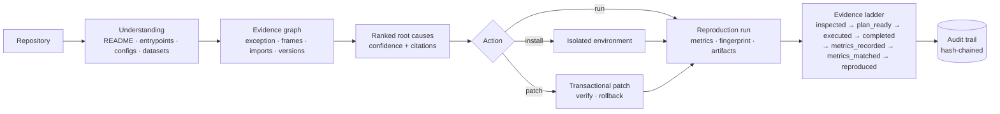

# RunFix

**An autonomous agent that runs, diagnoses, repairs and reproduces research code.**

[](CHANGELOG.md)
[](pyproject.toml)
[](LICENSE)
[](https://github.com/liaooss/RunFixMCP/actions)
[](docs/MCP_SERVER.md)

[中文](README.zh-CN.md) · [Documentation index](docs/INDEX.md) · [Project brief (中文)](docs/PROJECT_BRIEF.zh-CN.md)

> **A zero exit code is not a reproduction.** RunFix is built on that sentence: every claim it
> makes is backed by evidence it collected, and it says which rung of evidence it stopped at.

## Why

Running someone else's research code is not one problem, it is a chain of them. A tool that
only installs dependencies, or only parses a traceback, solves one link and stops.

| What actually happens | What RunFix does |
| --- | --- |
| The environment installs, but `train.py` still fails | Reads README, manifests, configs and entrypoints, then plans the environment **and** the run |
| The traceback says `ModuleNotFoundError`, but why? | Builds an evidence graph (exception → frames → imports → declared vs installed versions) and ranks root causes with citations |
| A patch "fixes" it, then breaks something else | Applies patches as durable transactions with pre/post hashes, verifies, and rolls back automatically on failure |
| `train.py` exits 0, nobody knows if the experiment ran | Extracts metrics, fingerprints the run, and refuses to call it a reproduction without declared targets |
| Nobody can tell a permission denial from a crash | Three-layer permission gates, one-shot approvals, and a hash-chained audit trail |

## What it does

| Capability | Command | Documentation |
| --- | --- | --- |
| Project scan and staged validation (C0–C5) | `runfix scan`, `runfix validate` | [ARCHITECTURE.md](docs/ARCHITECTURE.md) |
| Environment diagnosis (Python / PyTorch / CUDA / GPU) | `runfix diagnose` | [ARCHITECTURE.md](docs/ARCHITECTURE.md) |
| Evidence graph + ranked root causes | `runfix diagnose-root-cause` | [DIAGNOSIS.md](docs/DIAGNOSIS.md) |
| Transactional patching with rollback | `runfix patch-check / patch-apply / patch-recover` | [SAFETY.md](docs/SAFETY.md) |
| Autonomous plan–act–observe agent | `runfix agent [--resume]` | [AGENT_DESIGN.md](docs/AGENT_DESIGN.md) |
| Research experiment reproduction | `runfix reproduce` | [REPRODUCTION.md](docs/REPRODUCTION.md) |
| Docker / WSL isolation | `runfix reproduce --sandbox docker\|wsl` | [ARCHITECTURE.md](docs/ARCHITECTURE.md) |
| MCP server for Codex/Claude-style hosts | `runfix mcp` (23 tools) | [MCP_SERVER.md](docs/MCP_SERVER.md) |
| Multi-project web console | `runfix web` | [WEB_UI.md](docs/WEB_UI.md) |
| Audit trail and approvals | `runfix audit`, `runfix approvals` | [AUDIT_LOG.md](docs/AUDIT_LOG.md) |
| Self-measurement (benchmark + ablation) | `runfix bench` | [BENCHMARK.md](docs/BENCHMARK.md) |

## See it work

These are real outputs from this repository, not illustrations.

**Diagnosis** — a project that declares `numpy` but does not have it installed:

```text
$ runfix diagnose-root-cause . --traceback-file error.log
top kind   : module_declared_missing      conf=0.95  rank=1
statement  : 'numpy' is declared by the project but is not installed in the selected interpreter.
action     : install_package -> pip install numpy>=1.20
evidence   : requirements.txt, traceback, analysis (independent classifier agrees)
graph      : 11 nodes / 12 edges
```

**Reproduction** — the same project, with the metric the paper reports:

```text
$ runfix reproduce . --allow-execution --expect accuracy=0.8 --expect f1=0.74
verdict      : reproduced
run status   : completed (rc=0, 0.53s)
comparison   : accuracy match, f1 match
```

And when the evidence is not there, RunFix says so instead of claiming success:

| Situation | Verdict |
| --- | --- |
| No target metrics declared | `metrics_recorded` — "cannot be compared with the paper" |
| Process exits 0 but prints nothing | `executed` / `process_exited` — "a zero exit code alone is not evidence" |
| Declared `accuracy=0.99`, observed `0.80` | `metrics_recorded` — with expected / observed / allowed delta |
| Project has uncommitted changes | `metrics_matched` — cannot be tied to a commit |

## Install

Windows 10/11, Python 3.10+ (Anaconda or plain Python). Nothing is installed into the
interpreter you launch the script from.

```powershell
# Virtual environment, .venv/
Set-ExecutionPolicy -Scope Process Bypass
.\scripts\install_windows.ps1

# or: Conda prefix environment, .conda_env/ (does not touch your base env)
.\scripts\install_conda.ps1

# one-shot diagnosis of your installation (Python, git, conda, GPU, MCP handshake)
.\scripts\diagnose_windows.ps1
```

The installer ends by running the real MCP stdio self-check, so a green install is a verified
install. Manual equivalent:

```powershell
python -m pip install -e ".[dev,mcp]"
python -m runfix --version        # RunFix 1.0.0
python -m pytest -q               # 249 passed, 2 skipped
python -m runfix.mcp.smoke --full # 23/23 tools over the real protocol
```

## Quick start

```powershell
# 1. Understand a repository: README, entrypoints, configs, datasets, CUDA tags
runfix reproduce "D:\research\paper-code" --plan-only

# 2. Diagnose a real failure with cited evidence
runfix diagnose-root-cause "D:\research\paper-code" --traceback-file .\error.log

# 3. Let the agent work, under explicit permissions
runfix agent "D:\research\paper-code" --allow-project-code --allow-write --use-llm

# 4. Run the documented experiment and compare with the paper's numbers
runfix reproduce "D:\research\paper-code" --allow-execution --expect accuracy=0.812

# 5. Expose everything to an MCP host
runfix mcp --allowed-root "D:\research" --enable-execution --enable-write
```

## How it works



Three properties are enforced in code, not just documented:

1. **Nothing privileged happens without a gate.** Execution, writes and installation each need a
   server-side flag *and* a per-call confirmation; `--require-approval` adds an expiring,
   one-shot grant on top.
2. **Every mutation is reversible.** Patches run as transactions with before/after SHA-256
   hashes, a project-level lock, and crash recovery for half-applied transactions.
3. **Every claim is auditable.** Reports cite their evidence, runs carry a fingerprint, and
   privileged actions are appended to a hash chain that `runfix audit --verify` recomputes.

## How each step is decided

Full detail — formulas, decision tree, known weaknesses — is in
[docs/EVIDENCE_CRITERIA.md](docs/EVIDENCE_CRITERIA.md).

**1. Understand the project** — read-only, no `import`, no execution of project code.
README is parsed for install/run commands inside fenced blocks; entrypoints are ranked by name
base score **+40** for a README mention, **+20** for a `__main__` guard, **+15** for argparse,
**+10** for distributed code; configs are read with `json`/`tomllib`/PyYAML, or a flat-key scan
when PyYAML is absent; dataset keys are matched, resolved and existence-checked. Missing pieces
become `warnings`, never guesses.

**2. Diagnose the environment** — one subprocess probe of the selected interpreter, no installs.
Python requirement is compared as a numeric tuple (`true`/`false`/`null`); CUDA compatibility
compares the declared wheel tag (`cu121` → 12.1) with the driver's `CUDA Version` and yields
`supported` / `unsupported` / **`unknown`** — never a guess.

**3. Locate the root cause** — an evidence graph (`exception → raised_in → source → imports →
declares → resolved_to → tested_by`) plus 13 candidate kinds.
`confidence = base + min(0.09, 0.03×(evidence−1)) + corroboration − 0.12×contradictions`,
clamped to [0.05, 0.98]; ranking adds `0.01×min(5, evidence)`. If no rule fires, the answer is
`unclassified_error` at 0.30 with a request for more evidence.

**4. Controlled repair** — three gates (server flag → per-call confirmation → optional one-shot
approval), seven patch checks (path, `.git`, extension, per-segment symlinks, binary/submodule,
`git apply --check`, isolated `ast.parse`), and a transaction with before/after hashes.
Rollback only if **every** target still matches `sha256_after`; a crashed `applying` transaction
is restored, left alone, or flagged for review based on hashes. Applying a patch is not
repairing it — step 5 decides that.

**5. Run and collect evidence** — explicit argv, `shell=False`, timeout, combined log.
Five exclusive statuses: `failed_to_start`, `timed_out`, `failed`, `completed` (exit 0 **and**
completion evidence), `process_exited` (exit 0 **and no** evidence). Completion evidence is a
parsed metric, one of 13 markers, or your `--completion-regex`.

**6. Decide whether it reproduced** — the seven-rung ladder below. Metric targets use an
**absolute 0.02** tolerance when |value| ≤ 1 and **relative 2%** otherwise; every target is
`match`, `mismatch` or `missing`.

| Rung | Entry condition (all required) |
| --- | --- |
| `inspected` | the repository was read |
| `plan_ready` | an environment/run plan exists |
| `executed` | the command ran (timeout and failure count) |
| `completed` | exit code 0 **and** completion evidence |
| `metrics_recorded` | final metrics were parsed |
| `metrics_matched` | **every** declared target matched |
| `reproduced` | matched **and** the tree was clean during the run **and** a git commit exists |

`reproduced` means: on this machine, with this interpreter and this commit, the documented
command ran and the parsed metrics met the declared targets. It does **not** mean the paper is
correct, the method beats its baselines, or the result is statistically significant.

## Verification (last run on this machine)

| Check | Result |
| --- | --- |
| Test suite | **249 passed, 2 skipped** (Windows 11, Python 3.11) |
| MCP protocol | **23/23 tools** exercised over real stdio, exit 0 |
| Reproducibility benchmark | 11 tasks, top-1 accuracy 1.0, **0 files modified by diagnosis** |
| Ablation | dependency analysis worth **−36.4 pp**, score ranking **−9.1 pp** when removed |
| Audit chain | `{"ok": true, "checked": 3}` after real `reproduce` + `agent` + `approvals` |
| Packaging | wheel installs in a clean venv; `runfix --version` → 1.0.0 |

The two skipped tests need `SeCreateSymbolicLinkPrivilege`; they run automatically where the
account has it.

## What RunFix does **not** claim

- **Not verified:** real Docker/WSL execution (no daemon or distribution on the development
  machine), LLM planning and LLM-authored patches (no API key), accuracy on published research
  repositories (the benchmark suite is self-authored), browser-level UI testing.
- A passing test suite is not scientific correctness; a completed run is not a reproduced paper.
- RunFix never downloads datasets, weights or licensed assets without explicit authorization.
- No driver installation, no global `PATH` edits, no privilege elevation.

See [docs/ROADMAP.md](docs/ROADMAP.md) for the open items and
[docs/CURRENT_STATE_AUDIT.md](docs/CURRENT_STATE_AUDIT.md) for the full audit this project was
built from.

## Documentation

| Document | Contents |
| --- | --- |
| [docs/INDEX.md](docs/INDEX.md) | Map of all documentation |
| [docs/EVIDENCE_CRITERIA.md](docs/EVIDENCE_CRITERIA.md) | **The criteria behind every step**: rules, formulas, decision tree, known weaknesses ([中文](docs/EVIDENCE_CRITERIA.zh-CN.md)) |
| [docs/PROJECT_BRIEF.zh-CN.md](docs/PROJECT_BRIEF.zh-CN.md) | 项目简介（中文）：背景、定位、能力、架构、验证、边界 |
| [docs/ARCHITECTURE.md](docs/ARCHITECTURE.md) | Layers, data flow, product surface |
| [docs/DIAGNOSIS.md](docs/DIAGNOSIS.md) | Evidence graph, dependency resolution, confidence model |
| [docs/REPRODUCTION.md](docs/REPRODUCTION.md) | The evidence ladder and what each rung requires |
| [docs/BENCHMARK.md](docs/BENCHMARK.md) | Suite, metrics, ablations, what is not measured |
| [docs/SAFETY.md](docs/SAFETY.md) | Permission model and failure handling |
| [docs/AUDIT_LOG.md](docs/AUDIT_LOG.md) | Tamper-evident audit trail |
| [docs/MCP_SERVER.md](docs/MCP_SERVER.md) | 23 tools, gates, Codex configuration |
| [docs/WEB_UI.md](docs/WEB_UI.md) | Multi-project console |
| [docs/CURRENT_STATE_AUDIT.md](docs/CURRENT_STATE_AUDIT.md) | Evidence-based audit of every module |
| [CHANGELOG.md](CHANGELOG.md) | What changed in each release |

## Project status

`1.0.0` is the first complete release: the five-stage roadmap (stability → reproduction →
depth diagnosis → benchmarking → productisation) is implemented, tested and documented. The
open items are environmental rather than code gaps — see the table above.

## Contributing

Issues and pull requests are welcome. Please read [CONTRIBUTING.md](CONTRIBUTING.md) first: it
explains the "no claims without evidence" rule this project is built on, how to run the suite
and the MCP checks, and what a good bug report contains. By participating you agree to the
[Code of Conduct](CODE_OF_CONDUCT.md).

Security issues: please follow [SECURITY.md](SECURITY.md) instead of opening a public issue.

## License

[MIT](LICENSE). Third-party components and concepts are credited in
[THIRD_PARTY_NOTICES.md](THIRD_PARTY_NOTICES.md).

## Citation

If you use RunFix in academic work, see [CITATION.cff](CITATION.cff).

---

*RunFix is an assistant. It narrows the gap between "this repository does not run" and "this
experiment reproduces", and it is explicit about where that gap is still open.*
