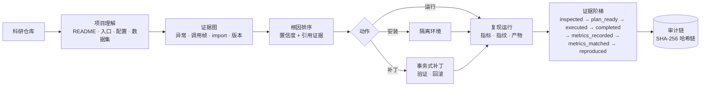

# RunFix

**面向科研代码的自主运行诊断、环境修复与实验复现 Agent。**

[](CHANGELOG.md)
[](pyproject.toml)
[](LICENSE)
[](https://github.com/liaooss/RunFixMCP/actions)
[](docs/MCP_SERVER.md)

[English](README.md) · [文档索引](docs/INDEX.md) · [项目简介（详细版）](docs/PROJECT_BRIEF.zh-CN.md)

> **退出码为 0，不等于实验复现成功。**
> RunFix 的每一条结论都必须有它自己采集到的证据支撑，并且会明确说明它停在了证据链的哪一级。

## 一、项目简介

### 1.1 要解决的问题

跑别人的科研代码，从来不是“一个”问题，而是一整条链：环境装不上、装上了跑不起来、跑起来了结果对不上。
只做“依赖安装”，或者只做“报错解释”的工具，只能解决其中一环。

| 真实场景 | RunFix 的做法 |
| --- | --- |
| 环境装好了，`train.py` 还是报错 | 读取 README、依赖清单、配置与入口脚本，同时规划**环境**和**运行** |
| 报错说 `ModuleNotFoundError`，但为什么？ | 构建证据图（异常 → 调用帧 → import → 已声明 vs 已安装版本），给出带引用的根因排序 |
| 改了一处“修好了”，结果别的地方坏了 | 补丁以事务方式应用（前后哈希 + 项目级锁），验证失败自动回滚 |
| `train.py` 退出码 0，但没人知道实验有没有跑完 | 提取指标、记录运行指纹，没有声明目标值就不宣称复现成功 |
| 分不清“权限被拒”和“服务崩溃” | 三层权限门禁 + 一次性审批 + 哈希链审计 |

### 1.2 项目定位

RunFix 是一个**有决策、执行、观察、修复和验证能力的 Agent**，把下面五件事组织成一条闭环，
而不是提供五个彼此独立的功能：

```
项目理解 → 环境诊断 → 根因定位 → 方案规划 → 受控执行 → 测试验证 → 结果反馈 → 自适应调整
```

参考了 Repo2Run（仓库到可运行环境）、Env-Doctor（环境与依赖诊断）、ResearchEnvBench（复现能力评测）
三个方向，差异化在于**把它们串成一条有证据链、可回滚、可审计的自主工作流**。

### 1.3 核心能力

| 能力 | 命令 | 文档 |
| --- | --- | --- |
| 项目扫描与 C0–C5 分层验证 | `runfix scan` / `runfix validate` | [ARCHITECTURE.md](docs/ARCHITECTURE.md) |
| 环境诊断（Python / PyTorch / CUDA / GPU） | `runfix diagnose` | [ARCHITECTURE.md](docs/ARCHITECTURE.md) |
| 证据图 + 根因排序 | `runfix diagnose-root-cause` | [DIAGNOSIS.md](docs/DIAGNOSIS.md) |
| 事务式补丁与回滚 | `runfix patch-check / patch-apply / patch-recover` | [SAFETY.md](docs/SAFETY.md) |
| 自主 Plan–Act–Observe Agent | `runfix agent [--resume]` | [AGENT_DESIGN.md](docs/AGENT_DESIGN.md) |
| 科研实验自动复现 | `runfix reproduce` | [REPRODUCTION.md](docs/REPRODUCTION.md) |
| Docker / WSL 隔离执行 | `runfix reproduce --sandbox docker\|wsl` | [ARCHITECTURE.md](docs/ARCHITECTURE.md) |
| MCP Server（23 个工具） | `runfix mcp` | [MCP_SERVER.md](docs/MCP_SERVER.md) |
| 多项目 Web 控制台 | `runfix web` | [WEB_UI.md](docs/WEB_UI.md) |
| 防篡改审计与审批 | `runfix audit` / `runfix approvals` | [AUDIT_LOG.md](docs/AUDIT_LOG.md) |
| 自评测（基准 + 消融） | `runfix bench` | [BENCHMARK.md](docs/BENCHMARK.md) |

### 1.4 技术亮点

1. **证据阶梯，而不是一句“成功”。**
   复现结论按 `inspected → plan_ready → executed → completed → metrics_recorded → metrics_matched → reproduced`
   逐级判定：`completed` 需要指标序列或完成标记，`metrics_matched` 需要调用方声明的目标值，
   `reproduced` 还要求工作区干净且有 git 提交。
2. **确定性置信度，可复算、可反驳。**
   根因候选的置信度 = 基础分 + 每条证据 0.03（上限 0.09）+ 独立分类器一致 0.06 − 每条反证 0.12，
   裁剪到 [0.05, 0.98]。这是“证据加权分”，不是学出来的概率，文档里写清楚了。
3. **双向可恢复。**
   补丁失败自动回滚；进程崩溃留下的半应用事务会在下次操作时恢复或标记为待人工复核；
   Agent 每一步写检查点，`--resume` 从下一步继续且不会重放已完成的副作用。
4. **权限只能收紧，不能放宽。**
   审批是一次性、带有效期的；恢复运行时沿用启动时的权限，无法借 `--resume` 提权。

## 二、实际效果

以下都是本仓库真实运行的输出，不是示意图。

**诊断**：项目声明了 `numpy` 但没安装——

```text
$ runfix diagnose-root-cause . --traceback-file error.log
top kind   : module_declared_missing      conf=0.95  rank=1
statement  : 'numpy' is declared by the project but is not installed in the selected interpreter.
action     : install_package -> pip install numpy>=1.20
evidence   : requirements.txt, traceback, analysis（独立分类器一致）
graph      : 11 nodes / 12 edges
```

**复现**：同一个项目，声明论文里的指标——

```text
$ runfix reproduce . --allow-execution --expect accuracy=0.8 --expect f1=0.74
verdict      : reproduced
run status   : completed (rc=0, 0.53s)
comparison   : accuracy match, f1 match
```

证据不足时，它不会假装成功：

| 情况 | 判定 |
| --- | --- |
| 没有声明目标指标 | `metrics_recorded` —— “无法与论文比较” |
| 进程退出码 0 但没有任何输出 | `executed` / `process_exited` —— “零退出码不是证据” |
| 声明 `accuracy=0.99`，实测 `0.80` | `metrics_recorded` —— 给出 expected / observed / 允许误差 |
| 工作区有未提交改动 | `metrics_matched` —— 结果无法绑定到某个 commit |

## 三、安装

Windows 10/11 + Python 3.10+（Anaconda 或普通 Python）。脚本**不会**装进你启动它的那个解释器。

```powershell
# 虚拟环境方案（.venv/）
Set-ExecutionPolicy -Scope Process Bypass
.\scripts\install_windows.ps1

# 或 Conda 前缀环境（.conda_env/，不动你的 base 环境）
.\scripts\install_conda.ps1

# 一键体检：Python / git / conda / GPU / MCP 握手
.\scripts\diagnose_windows.ps1
```

安装脚本最后会跑一次真实的 MCP stdio 自检，所以“安装成功”是验证过的成功。手动等价步骤：

```powershell
python -m pip install -e ".[dev,mcp]"
python -m runfix --version        # RunFix 1.0.0
python -m pytest -q               # 249 passed, 2 skipped
python -m runfix.mcp.smoke --full # 23/23 工具走真实协议
```

## 四、快速开始

```powershell
# 1. 只看不跑：读 README、识别入口/配置/数据集/CUDA 要求，输出环境与运行计划
runfix reproduce "D:\research\paper-code" --plan-only

# 2. 拿真实报错做证据化诊断
runfix diagnose-root-cause "D:\research\paper-code" --traceback-file .\error.log

# 3. 在明确授权下让 Agent 自主工作
runfix agent "D:\research\paper-code" --allow-project-code --allow-write --use-llm

# 4. 跑文档里的实验，并与论文指标对比
runfix reproduce "D:\research\paper-code" --allow-execution --expect accuracy=0.812

# 5. 接入 MCP 客户端（Codex / Claude Desktop 等）
runfix mcp --allowed-root "D:\research" --enable-execution --enable-write
```

## 五、工作原理



三条性质是**写在代码里**的，不只是文档承诺：

1. **特权操作必须有门禁。** 执行、写文件、装依赖，各自需要服务端开关 **加上** 单次调用确认；
   `--require-approval` 再叠加一次性、带有效期的审批。
2. **每一次修改都可回滚。** 补丁以事务执行，记录前后 SHA-256，带项目级锁，崩溃后能恢复半应用事务。
3. **每一条结论都可审计。** 报告引用证据，运行带指纹，特权操作进入哈希链，`runfix audit --verify` 可复算。

## 六、每一步的判定依据

下面把「理解项目 → 诊断环境 → 定位根因 → 受控修复 → 运行验证 → 判定是否复现」六步拆开，写清每一步**读什么、按什么规则判、判不出来怎么办**。
完整版（含公式推导、判定树伪代码、已知弱点）见 [docs/EVIDENCE_CRITERIA.zh-CN.md](docs/EVIDENCE_CRITERIA.zh-CN.md)。

### 6.1 理解项目：只读，不 import、不执行

| 证据 | 判定规则 |
| --- | --- |
| README | 按优先级找 `README.md/.rst/.txt`；只从代码块里提取 `pip/conda/python/torchrun` 开头的行，并剥掉 `$`、`>`、`PS>` 提示符 |
| 入口脚本 | 文件名基础分 **+** README 提及 +40 **+** `__main__` 守卫 +20 **+** argparse +15 **+** 分布式代码 +10，取前 10 名，每项都带 `evidence` |
| 配置 | 扫 `configs/ config/ conf/ cfg/ options/` 与根目录，深度 ≤4、单文件 ≤300KB、最多 60 个；YAML 无 PyYAML 时退化为平铺键扫描，并记录用的是哪个解析器 |
| 数据集 | 键名匹配 `data/dataset/corpus/...`，排除 `out/output/log/save/ckpt/result/weight` 等输出键；解析为绝对路径后检查是否存在 |
| 设备与 CUDA | 代码出现 `.cuda()` / `torch.cuda` / DDP，或 README 提到 GPU；`cu118` 这类轮子标签被记录下来供第二步判定 |

判不出来时：没有 README、没有入口、没有依赖清单都会写进 `warnings`，数据集缺失写进 `missing_datasets` 且**不会自动下载**。

### 6.2 诊断环境：用目标解释器探针，不装包

| 判定项 | 依据 | 结论 |
| --- | --- | --- |
| Python 兼容 | 解释器版本与 `requires-python` 按数字元组比较 | `true` / `false` / `null` |
| CUDA 兼容 | 声明的轮子标签（`cu121`→12.1）与驱动 `CUDA Version: X.Y` 比较 | 驱动 ≥ 所需 → `supported`；< → `unsupported`；缺任一 → **`unknown`** |
| 环境清单 | 固定优先级：`environment.yml` → `requirements.txt` → `pyproject.toml` | `manager` / `manifest` |
| GPU 风险 | 代码要 CUDA 但探针看不到 GPU | `at_risk` + 提示 |

**不做猜测**：没有轮子标签或拿不到驱动版本时，答案是“无法判定”而不是“大概可以”。

### 6.3 定位根因：证据图 + 可复算的置信度

先把异常、调用帧、源码文件、import、声明约束、实际版本、候选测试连成**证据图**（`failed_with`、`raised_in`、`imports`、`declares`、`resolved_to`、`tested_by` 等边），再生成 13 类候选。

| 判定项 | 依据 |
| --- | --- |
| 依赖问题 | 声明约束 vs 探针实际版本（自实现 PEP 440 子集）：`not_installed` / `version_unsatisfied` / `manifest_disagreement` / `python_incompatible` |
| 置信度 | `基础分 + min(0.09, 0.03×(证据数−1)) + 一致加分(分类器 +0.06 / CUDA +0.05) − 0.12×反证数`，裁剪到 [0.05, 0.98] |
| 排序 | `score = confidence + 0.01×min(5, 证据数)`，降序 |
| 何时不给结论 | 没有规则命中 → `unclassified_error`（0.30）+ 建议补采的证据，而不是编一个高置信度猜测 |

实算示例：`module_declared_missing` = 0.86（基础）+ 0.03（2 条证据）+ 0.06（分类器一致）= **0.95**。

### 6.4 受控修复：三道门禁 + 七道补丁闸 + 可回滚

- **三道门禁**：服务端开关（`--enable-write` 等）→ 单次调用确认 → 可选的一次性、带有效期审批。
- **七道补丁闸**：项目内相对路径 / 禁改 `.git`、`.runfix` / 扩展名白名单 / 逐段符号链接检查 / 拒绝二进制·子模块·符号链接补丁 / `git apply --check` / 隔离临时树里 `ast.parse`。
- **回滚判定**：所有目标文件当前哈希 == 记录的 `sha256_after` 才回滚，否则拒绝并列出冲突。
- **崩溃恢复**：`applying` 事务按哈希三态处理——等于 after → 恢复；等于 before → 不动；其它 → 标记待人工复核。
- **Agent 何时停**：由排名第一的根因动作决定；没有写权限就停在 `needs_write_permission_or_patch`，没有安装权限就停在 `needs_install_permission`，不硬闯。

**应用成功不等于修复成功**——必须过第五步。

### 6.5 运行验证：五态状态机

| 状态 | 依据 |
| --- | --- |
| `failed_to_start` | 进程没起来 |
| `timed_out` | 超时被杀 |
| `failed` | 退出码 ≠ 0 |
| `completed` | 退出码 0 **且**有完成证据 |
| `process_exited` | 退出码 0 **但没有任何**完成证据 |

**完成证据**（三者之一）：解析到 ≥1 个指标；命中 13 个完成标记之一（`training complete`、`all epochs`、`final results`…）；或匹配调用方给的 `--completion-regex`。

同时记录：git commit/branch/dirty、依赖清单 SHA-256、解释器与 torch/CUDA 版本、GPU 名称、运行期间新建或修改的文件。

### 6.6 判定是否复现：七级证据阶梯

**这是“是否复现”的正式判定**——取当前证据能支撑的最高一级，并写明为什么没有更高。

| 级别 | 进入条件（缺一不可） |
| --- | --- |
| `inspected` | 读过仓库 |
| `plan_ready` | 有环境/运行计划 |
| `executed` | 命令真的跑过（超时、失败也算） |
| `completed` | 退出码 0 **且**有完成证据 |
| `metrics_recorded` | 解析出最终指标 |
| `metrics_matched` | 声明的目标值**全部**匹配 |
| `reproduced` | 指标匹配 **且** 运行期间工作区干净 **且** 有 git commit |

指标比较规则：名称按别名表归一（`acc → accuracy`）；目标值 |v| ≤ 1 用**绝对容差 0.02**，否则用**相对 2%**；每个目标值记为 `match` / `mismatch` / `missing`。

```
没执行            → plan_ready
超时 / 失败 / 零退出码无输出 → executed（并写明原因）
退出码 0 且有完成证据        → completed
解析到指标                  → metrics_recorded
未声明目标值                → 停在 metrics_recorded，写明"无法与论文比较"
目标值全部匹配              → metrics_matched
工作区脏 / 无 git 提交      → 停在 metrics_matched
否则                       → reproduced
```

**`reproduced` 意味着**：在这台机器、这个提交、这套依赖下，文档里的命令跑通了，解析出的指标满足声明的目标值，且工作区干净。
**不意味着**：论文结论正确、方法优于基线、结果在别的机器上可重复、统计显著——这些都写在报告的 `limitations` 里。

### 6.7 已知弱点（不藏）

完成标记是启发式的（只写文件不打印的项目会用 `--completion-regex` 兜底）；指标只从 stdout/stderr 解析；别名表有限；目标值必须由人给出（RunFix 不读论文 PDF）；一次运行不算可重复性；干净 git 只保证可追溯、不保证正确。
完整讨论见 [docs/EVIDENCE_CRITERIA.zh-CN.md](docs/EVIDENCE_CRITERIA.zh-CN.md#已知弱点如实列出)。

## 七、验证结果（本机最后一次运行）

| 检查项 | 结果 |
| --- | --- |
| 测试套件 | **249 passed, 2 skipped**（Windows 11 / Python 3.11） |
| MCP 协议 | **23/23 工具**真实 stdio 调用，exit 0 |
| 可复现基准 | 11 个任务，top-1 准确率 1.0，**诊断修改文件数 0** |
| 消融实验 | 去掉依赖分析 **−36.4 个百分点**，去掉评分排序 **−9.1 个百分点** |
| 审计链 | 真实执行 `reproduce` + `agent` + `approvals` 后 `{"ok": true, "checked": 3}` |
| 打包 | wheel 在干净 venv 安装成功，`runfix --version` → 1.0.0 |

2 个跳过项需要 Windows 符号链接特权（`SeCreateSymbolicLinkPrivilege`），在具备该权限的账户上会自动执行。

## 八、明确不做宣称的部分

- **未验证**：真实 Docker/WSL 容器内执行（开发机无守护进程/无发行版）、LLM 规划与 LLM 生成补丁（无 API key）、
  真实已发表论文仓库上的准确率（基准集为自建）、浏览器级 UI 测试。
- 测试通过不等于科学正确；运行完成不等于论文复现。
- 未经授权不下载数据集、模型权重或许可资源。
- 不安装驱动、不改全局 `PATH`、不提权。

详见 [docs/ROADMAP.md](docs/ROADMAP.md) 的未完成项，以及 [docs/CURRENT_STATE_AUDIT.md](docs/CURRENT_STATE_AUDIT.md)
—— 整个项目就是从这份审计报告开始逐项重写与验证的。

## 九、文档

| 文档 | 内容 |
| --- | --- |
| [docs/INDEX.md](docs/INDEX.md) | 文档总索引 |
| [docs/EVIDENCE_CRITERIA.zh-CN.md](docs/EVIDENCE_CRITERIA.zh-CN.md) | **每一步的判定依据完整版**：六步流程的规则、公式、判定树与已知弱点 |
| [docs/PROJECT_BRIEF.zh-CN.md](docs/PROJECT_BRIEF.zh-CN.md) | 项目简介详细版（背景、定位、架构、验证、边界） |
| [docs/ARCHITECTURE.md](docs/ARCHITECTURE.md) | 分层结构、数据流、产品面 |
| [docs/DIAGNOSIS.md](docs/DIAGNOSIS.md) | 证据图、依赖求解、置信度模型 |
| [docs/REPRODUCTION.md](docs/REPRODUCTION.md) | 证据阶梯与每一级的要求 |
| [docs/BENCHMARK.md](docs/BENCHMARK.md) | 评测集、指标、消融、未测量项 |
| [docs/SAFETY.md](docs/SAFETY.md) | 权限模型与失败处理 |
| [docs/AUDIT_LOG.md](docs/AUDIT_LOG.md) | 防篡改审计 |
| [docs/MCP_SERVER.md](docs/MCP_SERVER.md) | 23 个工具、门禁、Codex 配置 |
| [docs/WEB_UI.md](docs/WEB_UI.md) | 多项目控制台 |
| [CHANGELOG.md](CHANGELOG.md) | 各版本变更记录 |

## 十、参与贡献

欢迎提 Issue 和 PR。请先读 [CONTRIBUTING.md](CONTRIBUTING.md)：里面写了本项目“无证据不下结论”的规则、
如何运行测试与 MCP 检查、以及一份好的 bug 报告应包含什么。参与即表示同意
[行为准则](CODE_OF_CONDUCT.md)。

安全问题请按 [SECURITY.md](SECURITY.md) 私下报告，不要开公开 Issue。

## 十一、许可与引用

[MIT](LICENSE)。第三方组件与思路来源见 [THIRD_PARTY_NOTICES.md](THIRD_PARTY_NOTICES.md)。
学术引用格式见 [CITATION.cff](CITATION.cff)。

---

*RunFix 是一个助手。它缩短“仓库跑不起来”到“实验复现成功”之间的距离，并且如实说明这段距离还有哪一段没有走完。*
