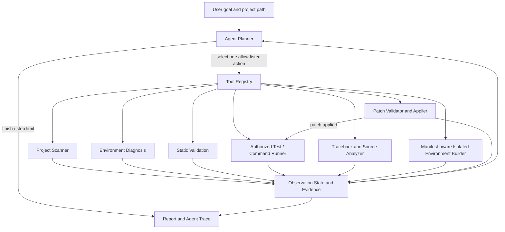

# RunFix Architecture (0.8.0)

RunFix is an agentic orchestration layer for Python-first research-code diagnosis, safe repair, experiment reproduction and isolated execution.

## Agent loop



## Agent components

1. **Planner (`runfix/agent/brain.py`)**
   - Calls an OpenAI-compatible LLM to choose the next tool when `--use-llm` is enabled and credentials are configured.
   - Falls back to a deterministic policy when the LLM is disabled, unavailable or returns an invalid action.
   - The planner receives only the currently authorized tool names; it cannot create arbitrary tools or shell commands.

2. **Tool registry (`runfix/agent/tools.py`)**
   - `scan_project`
   - `diagnose_environment`
   - `static_validation`
   - `run_tests`
   - `run_user_command` (only the exact command supplied by the user)
   - `analyze_failure`
   - `create_isolated_environment` (optional; Conda `environment.yml`, pip `requirements.txt`, or `pyproject.toml`)
   - `validate_patch`
   - `apply_patch`
   - `verify_after_patch`
   - `finish`

3. **Agent controller (`runfix/agent/core.py`)**
   - Maintains observations and tool history.
   - Selects the next available action, executes it, records evidence and loops.
   - Limits the run to 20 steps and at most two patch rounds.
   - Saves `report.json`, `report.md`, `execution.log` and `agent_state.json`.

4. **Safety policy**
   - Reading and static scanning are enabled by default.
   - Project-code execution requires `--allow-project-code`.
   - Patch application requires `--allow-write` and project-code permission.
   - Dependency installation requires explicit execution/install authorization and writes only to `<project>/.runfix/environments`, using a manifest-specific fingerprint.
   - No driver changes, global PATH edits, privilege elevation or arbitrary planner-provided shell commands.

## Upstream integrations

- Env-Doctor is an optional environment-diagnostic adapter.
- Repo2Run is an optional Linux/WSL2 environment-build adapter and is not automatically run by the planner.
- ResearchEnvBench concepts inform staged validation/reporting; RunFix does not claim to execute the full upstream benchmark.

## Limitations

- Python-first; supported environment manifests are Conda `environment.yml`, pip `requirements.txt`, and `pyproject.toml`.
- Poetry/uv lock solving, pause/resume for background tasks, and system driver repair are not automated.
- LLM planning and patch proposals require a configured API.
- A passing test suite is not proof of scientific correctness or exact paper reproduction.

## Background experiment tasks

`runfix.task_manager.TaskManager` launches explicit argv commands without a shell, persists task metadata and logs under `<project>/.runfix/tasks/`, and supports status polling, log tails, listing and termination. Each task records Git revision, interpreter, dependency-manifest hashes and an experiment fingerprint. PID start identities are checked before attempting to control a process after an MCP server restart.

Since 0.6.1 each task runs under a tiny supervisor (`<task-dir>/supervisor.py`) that starts the real command, waits for it and writes `process_result.json` with the true exit code. The task ID therefore survives a server restart with its result intact: `status()` reports `completed`/`failed` plus `returncode`, and `exit_code_source` says whether the code came from the live process handle or from the supervisor record. A task whose supervisor was killed as well falls back to `ended_unobserved` with `returncode: null`, which is the honest answer.

## Patch transaction lifecycle

`validate_patch` checks path boundaries, `git apply --check`, and parses changed Python files in a temporary tree. `apply_patch` creates a transaction directory with original snapshots and SHA-256 hashes before applying the diff. The transaction records the post-patch hashes after a successful apply.

`rollback_patch` first checks every current target against the recorded post-patch hash. If any target differs, it refuses the whole rollback rather than overwriting an independent edit. Otherwise it restores original files and removes files that were newly created by the patch. The Agent invokes this rollback automatically when post-patch verification fails.

**Concurrency (0.6.1).** `apply_patch` and `rollback_patch` run under a per-project lock: a module-level re-entrant thread lock plus an OS file lock on `<project>/.runfix/patch_transactions/.lock` (`msvcrt` byte-range on Windows, `flock` on POSIX). Validation happens before the lock; backup, `git apply` and metadata writes happen inside it, so two RunFix processes cannot interleave on the same project.

**Crash recovery (0.6.1).** A transaction left with `status: "applying"` (the process died between `git apply` and the status write) is resolved by `_recover_interrupted_locked`, which runs inside every lock acquisition and is also exposed as `runfix patch-recover`:

| Current file hash | Meaning | Action |
| --- | --- | --- |
| equals `sha256_after` | the patch was applied | restore the backups, status → `recovered_from_interrupt` |
| equals `sha256_before` | the patch never landed | leave the file alone, status → `recovered_from_interrupt` |
| anything else | someone edited the file after the crash | status → `interrupted_needs_review`, file untouched, reported to the caller |

Finished transactions are pruned only in states that can no longer be rolled back (`rolled_back`, `apply_failed`) and only beyond `TRANSACTION_RETENTION` entries; applied transactions are always kept, because deleting one would destroy the ability to roll back.

## Traceback-guided test selection

`runfix.test_selection.select_tests` extracts project-local traceback frames and compares their module names with static imports in pytest files. A matching subset is run first; if it passes, the full suite is run. If no reliable relationship is found, the full suite is run directly. This selection is a prioritization heuristic, not a formal dependency graph or a coverage guarantee.

## Experiment reproduction layer (0.7.0)

```
repro/understanding.py  → repro/plan.py → repro/runner.py → repro/metrics.py → repro/report.py
        (read-only)          (read-only)     (authorized)        (read-only)        (read-only)
                                             repro/pipeline.py orchestrates the above
```

- **understanding** never imports target modules and never runs target code. It parses the
  README, ranks entrypoints with per-score evidence, parses configuration (PyYAML when
  available, a flat-key scanner otherwise), extracts seeds and training parameters, resolves
  dataset paths, and detects device requirements and declared CUDA wheel tags.
- **plan** turns that into explicit steps. It compares the declared wheel tag with the
  driver's maximum CUDA version and returns `supported` / `unsupported` / `unknown`; a missing
  input always yields `unknown`. Every step carries `requires_authorization`.
- **runner** executes exactly one argv command with `shell=False`, a timeout, and a log under
  `.runfix/repro/<run-id>/`. It records exit code, duration, git commit/branch/dirty,
  dependency-manifest hashes, interpreter and framework versions, GPU names, and every file
  created while the run was in flight.
- **metrics** parses `key=value`, `key: value`, JSON lines and percentages, normalising common
  aliases, and keeps the source line for each observation.
- **report** derives the verdict from evidence, never from the exit code alone:

  `inspected → plan_ready → executed → completed → metrics_recorded → metrics_matched → reproduced`

  `completed` needs a metric series or a completion marker. `metrics_matched` needs
  caller-declared targets. `reproduced` additionally needs a clean git tree.

The reproduction layer shares no state with the repair transaction machinery: it writes only
under `.runfix/repro/` and never patches project files.

## Evidence-based diagnosis layer (0.8.0)

```
diagnosis/evidence.py   → diagnosis/dependencies.py → diagnosis/rootcause.py
        (graph)                 (constraints)              (ranked candidates)
```

`evidence.py` builds a typed graph: the exception and its project-local frames, every source
file that imports a module, every declared requirement and its installed counterpart, and the
test files selected from the traceback. `dependencies.py` implements the PEP 440 subset the
manifests use and compares it with the selected interpreter. `rootcause.py` turns both into
ranked candidates, each with a deterministic confidence, the facts that raised it, the facts
that would contradict it, and one action.

The agent consumes this through `analyze_failure`, which now returns `root_causes`; the policy
decides from the top candidate's action (`install_package`, `patch_source`, `select_interpreter`,
`configure_data`, `select_cuda_wheel`, …) rather than from the coarse failure category. Every
step records `strategy = root_cause:<kind>`.

Confidence is a score over cited evidence (base per kind, +0.03 per extra citation capped at
+0.09, +0.06 for independent classifier agreement, −0.12 per contradiction, clamped to
[0.05, 0.98]). It is not a learned probability and the report says so.

## Isolation layer (0.8.0)

`runfix/sandbox.py` provides two optional backends:

| Backend | Command shape |
| --- | --- |
| `docker` | `docker run --rm -i -v <project>:/workspace -w /workspace --network none <image> <argv>` |
| `wsl` | `wsl [-d <distro>] --cd <project-as-/mnt/...> -- <argv>` |

`ensure_backend` probes the executable (and, for WSL, that a distribution exists) and raises
with an actionable message. RunFix refuses to silently run unsandboxed: a missing backend is a
hard error, not a fallback. Inside Docker the interpreter substitution is skipped (the image
provides it) and project paths are rewritten to `/workspace`; the run record keeps both the
logical `command` and the `launch_command` plus `interpreter_resolution`.

## Observation-driven offline policy (0.7.0 / 0.8.0)

`runfix/agent/policy.py` replaces the fixed tool sequence that 0.6.x used. It reads the
observations — ranked root causes, failure category, patch state, previous analysis, last
verification — and returns a decision with a rationale, an optional `strategy`, and a
`stop_reason` when it stops. Representative stops:

| Evidence | Decision |
| --- | --- |
| runtime passed | `finish` with `verified_baseline` |
| top root cause wants a package install, install authorized | `create_isolated_environment` |
| top root cause wants a package install, install unauthorized | `finish` with `needs_install_permission` |
| top root cause needs a specific interpreter / data path / CUDA wheel / manifest decision | `finish` with `needs_interpreter_selection` / `needs_data_configuration` / `needs_cuda_wheel_selection` / `needs_manifest_decision` |
| top root cause is `patch_source`, write authorized | `validate_patch` → `apply_patch` → `verify_after_patch` |
| top root cause is `patch_source`, write unauthorized | `finish` with `needs_write_permission_or_patch` |
| GPU OOM | `finish` with `needs_configuration_change` |
| repeated failure | re-analyze instead of repeating the same patch |
| unclassified failure | `finish` with `no_evidence_backed_repair` |

The policy still cannot generate code patches: patch text comes from the LLM planner. It
decides *whether and when* to act, not *what code to write*.
